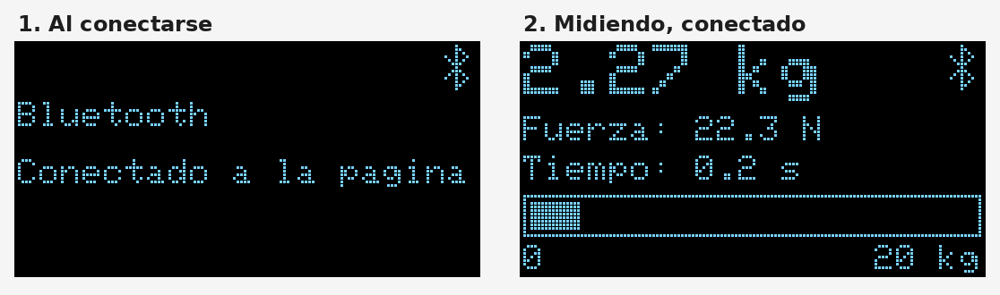

# P01 · Ejercitador de fuerza

Ejercitador de agarre para rehabilitación. Una celda de carga de 20 kg mide la fuerza; el ESP32 la muestra en una pantalla OLED y la envía por Bluetooth a una página web con lecturas en vivo y recomendaciones.

**Estado:** En pruebas · **Fecha:** noviembre de 2026

## Qué muestra

- Peso en kg, fuerza en newtons y tiempo sostenido.
- Barra de fuerza de 0 a 20 kg y aviso de sobrecarga.
- Icono de Bluetooth cuando la página está conectada.
- En la página: gráfica de los últimos 30 s, registro de cada repetición, metas ajustables y recomendaciones (fuerza, tiempo, descanso y cansancio).

## Componentes

| Componente | Detalle |
|---|---|
| Microcontrolador | ESP32 (DevKit) |
| Sensor | Celda de carga de 20 kg + módulo HX711 (XFW-HX711) |
| Pantalla | OLED I2C 128×64 (SSD1306) |

## Conexiones

| Módulo | Pin | ESP32 |
|---|---|---|
| OLED | SDA | GPIO 21 |
| OLED | SCK | GPIO 22 |
| OLED | VDD / GND | 3V3 / GND |
| HX711 | DT | GPIO 18 |
| HX711 | SCK | GPIO 19 |
| HX711 | VCC / GND | 3V3 / GND |

## Firmware

| Carpeta | Para qué sirve |
|---|---|
| `firmware/ejercitador_bluetooth/` | Programa principal: pantalla, medida y Bluetooth |
| `firmware/calibrar_fuerza/` | Calibra la celda con un peso conocido y guarda el factor en el ESP32 |
| `firmware/diagnostico/` | Revisa si el HX711 y la celda responden |

Librerías (Gestor de librerías de Arduino IDE): **HX711 Arduino Library** (Bogdan Necula) y **Adafruit SSD1306** (con Adafruit GFX). El Bluetooth ya viene con la placa ESP32.

Calibración actual: factor **133393.39**, medido con 2.27 kg. Ya está incluido en el programa principal.

Si al subir aparece `Wrong boot mode`, mantén presionado **BOOT** mientras sale `Connecting...`.

## Página

Se abre desde la página principal o en `.../01-ejercitador-fuerza/`. Funciona en **Chrome** (Android, Windows, Mac) o **Edge**; en iPhone no funciona con Safari.

1. Enciende el ESP32 sin tocar el agarre.
2. Toca **Conectar** y elige **Ejercitador**.
3. Ajusta las metas de fuerza, tiempo, repeticiones y descanso.

El botón **Probar sin dispositivo** muestra la página con datos simulados.

Las recomendaciones son orientativas y se basan solo en la fuerza y el tiempo medidos.
